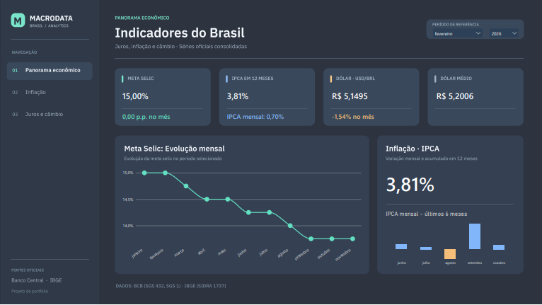
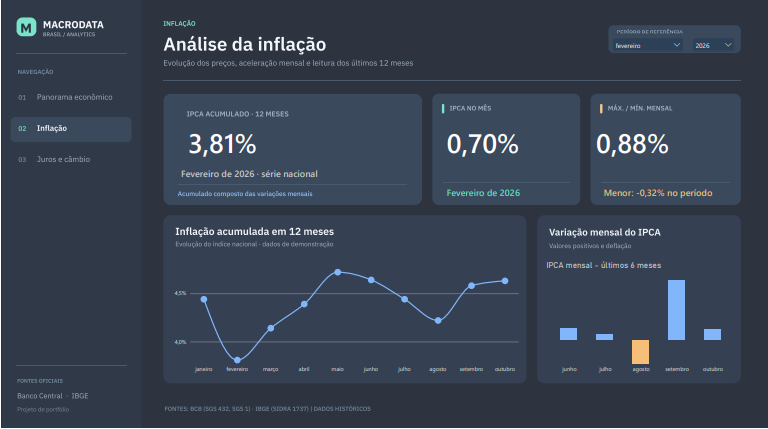
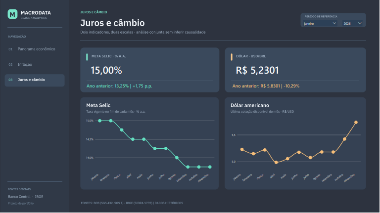

# MacroData Brasil

Projeto de Engenharia e Análise de Dados desenvolvido com **Python, Google Cloud, BigQuery, SQL e Power BI**, utilizando dados oficiais do Banco Central do Brasil e do IBGE.

O projeto reúne séries históricas da Taxa Selic, IPCA e câmbio USD/BRL em uma estrutura de dados na nuvem, com processos de extração, transformação, validação e visualização.

## Dashboard



O dashboard foi desenvolvido no Power BI e organizado em três páginas: Panorama Econômico, Inflação e Juros e Câmbio. Os layouts foram planejados no Figma antes da implementação dos visuais e indicadores.

## Tecnologias utilizadas

- **Python:** integração com APIs REST, processamento e orquestração do pipeline.
- **Google Cloud Platform:** ambiente em nuvem utilizado no projeto.
- **Google BigQuery:** armazenamento, consultas e transformações dos dados.
- **SQL:** tratamento, deduplicação, consolidação e cálculo dos indicadores.
- **Google Colab:** notebooks de extração e reprocessamento histórico.
- **Power BI:** modelagem de dados, medidas DAX e desenvolvimento dos dashboards.
- **Figma:** prototipação dos layouts e definição da identidade visual.
- **Git e GitHub:** versionamento do código e documentação.

## Arquitetura de dados

Estruturei o processamento seguindo a arquitetura Medallion, separando os dados em três camadas no BigQuery.

```text
Banco Central (SGS)        IBGE (SIDRA)
        |                       |
        +-----------+-----------+
                    |
              Python / APIs
                    |
             Google BigQuery
                    |
                  Bronze
                    |
                  Silver
                    |
                   Gold
                    |
            vw_macro_mensal
                    |
                 Power BI
```

### Google Cloud e BigQuery

Criei o projeto `macrodata-brasil` no Google Cloud e configurei o BigQuery na região `southamerica-east1` (São Paulo).

Organizei o ambiente em três datasets:

| Dataset | Estrutura |
|---|---|
| `bronze` | Dados originais extraídos das APIs e informações de rastreabilidade |
| `silver` | Dados tratados, tipados, validados e deduplicados |
| `gold` | Indicadores consolidados e cálculos utilizados nas análises |

O ambiente utiliza o **BigQuery Sandbox**, sem faturamento habilitado.

As transformações são executadas por scripts SQL versionados no projeto. Também utilizei o Google Cloud CLI para configurar a autenticação local e permitir a execução do pipeline Python diretamente pelo VS Code.

### Bronze - Ingestão

Integrei três fontes oficiais:

- **Meta Selic:** Banco Central, série SGS 432.
- **Câmbio USD/BRL:** Banco Central, série SGS 1.
- **IPCA mensal:** IBGE/SIDRA, tabela 1737, variável 63.

A extração é realizada por Python, utilizando requisições HTTP às APIs.

Os dados passam por tabelas de staging antes de serem consolidados com o histórico existente. A consolidação utiliza tabelas candidatas, que são validadas antes da promoção para a Bronze oficial.

### Silver - Tratamento

Na Silver, desenvolvi as consultas SQL responsáveis pela conversão de datas e valores, remoção de registros inválidos e deduplicação.

Para manter uma observação por data ou competência, utilizei funções de janela como `ROW_NUMBER()`, considerando a data de extração dos registros.

### Gold - Indicadores

A Gold reúne os dados em tabelas mensais:

| Tabela | Indicadores |
|---|---|
| `selic_mensal` | Última taxa do mês e variação em pontos percentuais |
| `ipca_mensal` | IPCA mensal e acumulado composto em 12 meses |
| `cambio_mensal` | Cotação de fechamento, média e variação percentual mensal |

Também criei a view `gold.vw_macro_mensal`, consolidando as três fontes para consumo no Power BI.

Nos cálculos, utilizei funções SQL como `LAG()`, `DATE_TRUNC()`, `AVG()` e funções de janela para calcular as variações dos indicadores.

## Pipeline Python

Desenvolvi um pipeline para executar as etapas de ingestão e transformação pelo VS Code, sem precisar rodar os notebooks individualmente.

O processamento inclui:

1. Extração incremental das APIs.
2. Validação e carregamento dos dados em staging.
3. Consolidação e auditoria das tabelas candidatas.
4. Criação de backups e promoção para a Bronze.
5. Atualização das camadas Silver e Gold.
6. Validação da view consolidada.

A atualização é feita manualmente, conforme a necessidade do projeto.

Para executar o pipeline completo:

```bash
python src/executar_pipeline.py
```

Para verificar os arquivos SQL antes do processamento:

```bash
python src/executar_pipeline.py --verificar
```

### Validações e reprocessamento histórico

Implementei verificações de duplicidade, consistência de valores, preservação de registros históricos e comparação entre tabelas.

O projeto também possui backups de recuperação e semanais no BigQuery.

Para situações em que preciso reconstruir o histórico, desenvolvi o notebook `04_reprocessamento_historico.ipynb`. Ele realiza uma nova extração das três fontes, carrega tabelas históricas de staging, valida os registros e permite reconstruir a Bronze mediante habilitação manual.

Depois da reconstrução, as camadas Silver e Gold podem ser atualizadas com:

```bash
python src/atualizar_camadas.py
```

Como o projeto utiliza o BigQuery Sandbox, as tabelas estão sujeitas às regras de expiração do serviço.

## Design e prototipação no Figma

Antes de implementar o relatório no Power BI, utilizei o Figma para desenhar os layouts das três páginas.

Nessa etapa, defini a organização dos cards e gráficos, navegação lateral, paleta de cores, tipografia e espaçamentos.

Escolhi uma identidade visual escura, utilizando cores diferentes para destacar indicadores de juros, inflação e câmbio.

Com os layouts definidos, reproduzi a estrutura no Power BI, conectando os visuais às medidas DAX e aos dados consolidados no BigQuery.

**[Visualizar os layouts no Figma](https://www.figma.com/design/puMf5U8OI1LRzF2PdUjX5k/MacroData-Brasil-Dashboard-Power-BI?node-id=0-1)**

## Dashboard no Power BI

Conectei o Power BI Desktop à view `gold.vw_macro_mensal` do BigQuery, utilizando o modo de importação.

No modelo, trabalhei com uma tabela de indicadores mensais, uma dimensão calendário e medidas DAX para os cálculos utilizados nos visuais.

### 01 - Panorama Econômico


Página com os principais indicadores macroeconômicos, incluindo Selic, IPCA acumulado em 12 meses, câmbio de fechamento e cotação média do dólar.

Também apresenta a evolução mensal dos indicadores e filtros de período.

### 02 - Inflação



Página dedicada ao IPCA, com indicadores mensais, acumulado em 12 meses, valores máximos e mínimos e gráficos de evolução histórica.

### 03 - Juros e Câmbio



Página com a evolução da Meta Selic e do dólar americano, incluindo comparações com o ano anterior e gráficos individuais para acompanhar o comportamento dos dois indicadores.

O arquivo do relatório está disponível em [`powerbi/MacroData_Brasil.pbix`](powerbi/MacroData_Brasil.pbix).

## Estrutura do projeto

```text
MacroData-Brasil/
├── docs/
│   └── images/
│       ├── pagina-01-panorama.png
│       ├── pagina-02-inflacao.png
│       └── pagina-03-juros-cambio.png
├── notebooks/
│   ├── 01_extracao_bcb.ipynb
│   ├── 02_extracao_ibge.ipynb
│   ├── 03_extracao_cambio.ipynb
│   └── 04_reprocessamento_historico.ipynb
├── powerbi/
│   └── MacroData_Brasil.pbix
├── sql/
│   ├── bronze/
│   ├── silver/
│   └── gold/
├── src/
│   ├── atualizar_camadas.py
│   ├── backup_bronze.py
│   ├── config.py
│   ├── executar_pipeline.py
│   ├── pipeline.py
│   ├── promover_bronze.py
│   └── validar_promocao.py
├── .gitignore
├── README.md
└── requirements.txt
```

## Execução local

Para executar o projeto, é necessário ter Python instalado, acesso ao ambiente do Google Cloud e as permissões necessárias no BigQuery.

Instale as dependências:

```bash
pip install -r requirements.txt
```

Configure a autenticação local:

```bash
gcloud auth application-default login
gcloud config set project macrodata-brasil
```

Execute a verificação:

```bash
python src/executar_pipeline.py --verificar
```

Para processar os dados:

```bash
python src/executar_pipeline.py
```

O código utiliza o projeto e os datasets configurados em `src/config.py`. Para executar em outro projeto Google Cloud, é necessário criar os datasets e tabelas correspondentes e ajustar as referências dos scripts SQL.

## Fontes de dados

- [Banco Central do Brasil - Dados Abertos](https://dadosabertos.bcb.gov.br/)
- [IBGE - SIDRA](https://sidra.ibge.gov.br/)

---

**MacroData Brasil** - Projeto pessoal de Engenharia e Análise de Dados.